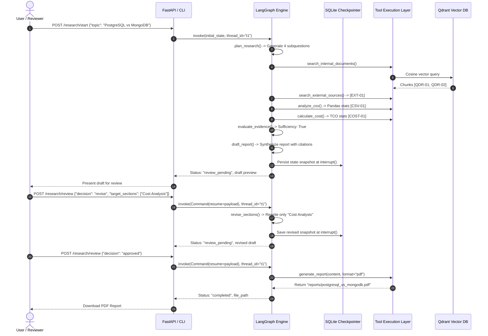

# Software Design Specification (SDS)

**Project Name**: AI Research & Report Generation Agent  
**Document Version**: 1.0  
**Status**: Approved  
**Author**: Engineering Team  
**Date**: October 2026  

---

## 1. System Architecture Overview

The system is designed around an autonomous, stateful agent orchestrated by **LangGraph**. It combines semantic retrieval from vector stores, deterministic algorithmic execution for tabular and financial calculations, cyclic graph execution with safety guardrails, and persistent checkpointing for human-in-the-loop review.

### Architectural Principles
1. **Separation of Reasoning and Calculation**: LLMs generate hypotheses, decompose questions, and synthesize narrative; deterministic Python tools (Pandas and mathematical engines) handle numerical aggregation and pricing.
2. **Strictly Typed State Machine**: Every node consumes and emits typed state schemas, preventing state corruption across cycles.
3. **Non-Destructive Human Control**: Human feedback halts the graph via checkpointing, enabling section-level revisions without invalidating collected evidence.
4. **Traceable Grounding**: All assertions map deterministically to registered source identifiers.

---

## 2. Five-Layer Architecture Blueprint

```
┌─────────────────────────────────────────────────────────────────────────────┐
│                       1. PRESENTATION & CLIENT LAYER                         │
│   • FastAPI REST Interface (/research/start, /research/review, /reports)   │
│   • Web-based Review Dashboard (Draft viewer, section diffs, feedback form) │
│   • Interactive Command-Line Interface (CLI runner: main.py)                │
└──────────────────────────────────────┬──────────────────────────────────────┘
                                       │ HTTP / In-Process Call
┌──────────────────────────────────────▼──────────────────────────────────────┐
│                    2. ORCHESTRATION & STATE MACHINE LAYER                    │
│   LangGraph StateGraph Runtime                                              │
│   ├── Typed State Schema (ResearchState)                                    │
│   ├── Checkpoint Store (SqliteSaver / PostgresSaver)                        │
│   ├── LangSmith Tracing & Observability Hooks                               │
│   └── Human-in-the-Loop Interrupt Controller (interrupt() & resume Command) │
└──────────────────────────────────────┬──────────────────────────────────────┘
                                       │ Node Invocations & Routing Edges
┌──────────────────────────────────────▼──────────────────────────────────────┐
│                      3. AGENT REASONING & DECISION NODES                     │
│   [Plan Research] ──> [Evidence Evaluator] ──> [Sufficiency Gate]           │
│          ▲                     │                      │                     │
│          │ (Loop Refinement)   ▼                      ▼                     │
│          └────────────── [Gap Analyzer]        [Report Drafter]             │
│                                                       │                     │
│   [Report Exporter] <── [Review Router] <── [Section Reviser]               │
└──────────────────────────────────────┬──────────────────────────────────────┘
                                       │ Tool Calls
┌──────────────────────────────────────▼──────────────────────────────────────┐
│                           4. TOOL EXECUTION LAYER                            │
│   ┌───────────────────────────────┐     ┌────────────────────────────────┐  │
│   │ search_internal_documents     │     │ search_external_sources        │  │
│   │ (Qdrant Vector Search + Filter)│    │ (Mock External Registry)       │  │
│   ├───────────────────────────────┤     ├────────────────────────────────┤  │
│   │ analyze_csv                   │     │ calculate_cost                 │  │
│   │ (Pandas Statistical Engine)   │     │ (Deterministic Pricing Model)  │  │
│   ├───────────────────────────────┴─────┴────────────────────────────────┤  │
│   │ generate_report (ReportLab PDF / python-docx Exporter)               │  │
│   └──────────────────────────────────────────────────────────────────────┘  │
└──────────────────────────────────────┬──────────────────────────────────────┘
                                       │ I/O Operations
┌──────────────────────────────────────▼──────────────────────────────────────┐
│                     5. DATA & PERSISTENCE STORAGE LAYER                      │
│   • Qdrant Vector DB (Chunked database_comparison.pdf & guidelines.md)      │
│   • Relational Checkpoints (SQLite checkpoints.db / PostgreSQL)             │
│   • Tabular Data (benchmark_results.csv) & Pricing (cloud_pricing.json)     │
│   • Export Artifacts Directory (reports/*.pdf, reports/*.docx)              │
└─────────────────────────────────────────────────────────────────────────────┘
```

---

## 3. LangGraph Workflow & State Machine

### 3.1 State Graph Diagram

```mermaid
flowchart TD
    START([User Topic / Goal]) --> N1[1. plan_research<br/>Decompose into ≥3 subquestions]
    
    subgraph Evidence & Analytics Phase
        N1 --> N2[2. gather_evidence<br/>Internal Qdrant + External Sources]
        N2 --> N3[3. execute_calculations<br/>analyze_csv + calculate_cost]
        N3 --> N4[4. evaluate_evidence<br/>Check coverage against subquestions]
    end

    N4 --> CondSuff{Evidence<br/>Sufficient?}
    CondSuff -- "No (iteration < 2)" --> N2
    CondSuff -- "Yes (or max iterations)" --> N5[5. draft_report<br/>Cite sources & flag unsupported]

    subgraph Human-in-the-Loop Phase
        N5 --> N6[6. human_review<br/>interrupt() checkpoint pause]
        N6 -.-> UserDecision{Reviewer Decision}
    end

    UserDecision -- "revise" --> N7[7. revise_sections<br/>Preserve evidence; patch named sections]
    N7 --> N6
    
    UserDecision -- "reject" --> N8([Workflow Terminated])
    
    UserDecision -- "approve" --> N9[8. export_report<br/>Generate PDF / DOCX]
    N9 --> END([Final Report Exported])
```

### 3.2 State Schema (`ResearchState`)

The workflow operates on a typed dictionary defined in `src/state.py`:

```python
from typing import Annotated, List, Dict, Any, Optional, Literal
from typing_extensions import TypedDict
import operator

class EvidenceItem(TypedDict):
    source_id: str                      # Canonical ID: QDR-01, EXT-01, CSV-01, COST-01
    source_type: Literal["internal_qdrant", "external_mock", "tabular_csv", "cost_calculation"]
    title: str
    content: str
    reliability_score: float
    metadata: Dict[str, Any]

class HumanFeedback(TypedDict):
    decision: Literal["approved", "revise", "rejected"]
    feedback_notes: str
    target_sections: List[str]          # Specific sections to modify during revision

class DraftReport(TypedDict):
    title: str
    sections: Dict[str, str]            # Section name -> Markdown content with citations
    cited_sources: List[str]            # List of cited source_ids
    unsupported_claims: List[str]       # Claims made without source backing

class ResearchState(TypedDict):
    topic: str
    subquestions: List[str]
    evidence: Annotated[List[EvidenceItem], operator.add]   # Monoid accumulator across loops
    calculations: Dict[str, Any]                            # Structured numerical results
    iteration_count: int
    is_sufficient: bool
    missing_gaps: List[str]
    draft_report: Optional[DraftReport]
    unsupported_claims: List[str]
    human_feedback: Optional[HumanFeedback]
    final_report_path: Optional[str]
    status: Literal["planning", "gathering", "calculating", "evaluating", "drafted", "review_pending", "revised", "approved", "rejected", "completed"]
```

---

## 4. Subsystem Design & Technical Specifications

### 4.1 Ingestion & Vector Retrieval Subsystem (Qdrant)
* **Local Embedded Mode**: Qdrant runs in embedded storage mode (`path=data/qdrant_storage`), writing to disk without requiring an external container runtime.
* **Embeddings**: `sentence-transformers/all-MiniLM-L6-v2` generating 384-dimensional dense vectors with cosine similarity distance metric.
* **Document Chunking Strategy**:
  * PDF documents parsed using `PyPDF` and split with a `RecursiveCharacterTextSplitter` (chunk size: 500 characters, overlap: 100 characters).
  * Markdown parsed and split by headers (`#`, `##`, `###`) to preserve logical section hierarchy.
* **Metadata Payload Schema**:
  ```json
  {
    "source_file": "database_comparison.pdf",
    "doc_type": "pdf",
    "section": "Multi-Tenant Isolation Strategies",
    "chunk_index": 2
  }
  ```
* **Filtered Query Mechanism**: The `search_internal_documents` tool dynamically builds Qdrant filters:
  ```python
  from qdrant_client.models import Filter, FieldCondition, MatchValue

  query_filter = Filter(must=[FieldCondition(key="doc_type", match=MatchValue(value="pdf"))])
  ```

### 4.2 Tabular Analysis & Cost Calculator Subsystem
* **Pandas Statistical Engine (`analyze_csv`)**:
  * Ingests `data/sample_data/benchmark_results.csv`.
  * Computes deterministic aggregations:
    * Grouped mean, standard deviation, and p50/p95/p99 latency by database and operation type (`read` vs. `write`).
    * Operations per second throughput benchmarks grouped by concurrency tier (50, 100, 200 connections).
  * Results returned as structured JSON, completely bypassing generative arithmetic.
* **Deterministic Cost Engine (`calculate_cost`)**:
  * Ingests `data/sample_data/cloud_pricing.json`.
  * Computes monthly and multi-year TCO formulas:
    $$\text{Monthly Cost} = (\text{Price}_{\text{compute}} \times \text{Hours}) + (\text{Price}_{\text{storage}} \times \text{GB}) + (\text{Backup}) + (\text{Support})$$
  * Allows parameterized comparison (e.g., 1-year vs. 3-year TCO at 500GB scale).

### 4.3 Human-in-the-Loop & Persistence Subsystem
* **Interrupt Boundary**: In `src/graph/nodes.py`, the `human_review` node halts the execution thread by triggering:
  ```python
  from langgraph.types import interrupt

  def human_review(state: ResearchState):
      feedback = interrupt({
          "draft_report": state["draft_report"],
          "unsupported_claims": state["unsupported_claims"],
          "actions_available": ["approved", "revise", "rejected"]
      })
      return {"human_feedback": feedback, "status": "reviewed"}
  ```
* **Checkpoint Engine**: Configured with `SqliteSaver.from_conn_string("data/checkpoints.db")`.
* **State Resumption Logic**:
  * The thread is resumed using `graph.invoke(Command(resume=review_payload), config={"configurable": {"thread_id": thread_id}})`.
  * When `decision == "revise"`, the state navigates to `revise_sections`.
  * **Surgical Revision**: The node extracts existing evidence and queries the LLM with a targeted rewrite prompt that strictly touches `state["draft_report"]["sections"][target_section]`, preserving all other report sections and previous evidence.

### 4.4 Report Generation & Export Subsystem
* **PDF Engine (ReportLab)**:
  * Uses `SimpleDocTemplate` with custom styles.
  * Structural layout:
    1. Header banner with title, generation timestamp, and approval metadata.
    2. Executive Summary callout.
    3. Architecture comparison table.
    4. Benchmark results table (populated dynamically from Pandas analysis).
    5. Cost model projection breakdown.
    6. Limitations & Unsupported Claims block.
    7. Bibliographic references index matching `[source_id]` tags.
* **DOCX Engine (python-docx)**:
  * Emits corresponding structured `.docx` files formatted with native Word typography and tables.

---

## 5. Sequence Diagram: Full End-to-End Execution Flow



---

## 6. Security, Reliability & Error Handling

* **Anti-Hallucination Guardrail**: The drafting prompt uses few-shot constraints prohibiting ungrounded numerical assertions. Any uncited factual claims are isolated into `unsupported_claims`.
* **Idempotency**: Document export operations compute deterministic output paths based on sanitized topic slugs and thread IDs (`reports/{topic_slug}_{thread_id}.pdf`), preventing duplicate writes and collision issues.
* **Loop Termination Guarantee**: An explicit counter `iteration_count` increments on every retrieval retry. Upon exceeding `MAX_RESEARCH_ITERATIONS`, the graph automatically forces transition to `draft_report`.
* **Database Graceful Degradation**: If Qdrant returns zero chunks for an overly specific filter, the internal search tool falls back to an unconstrained semantic search before reporting missing evidence.
